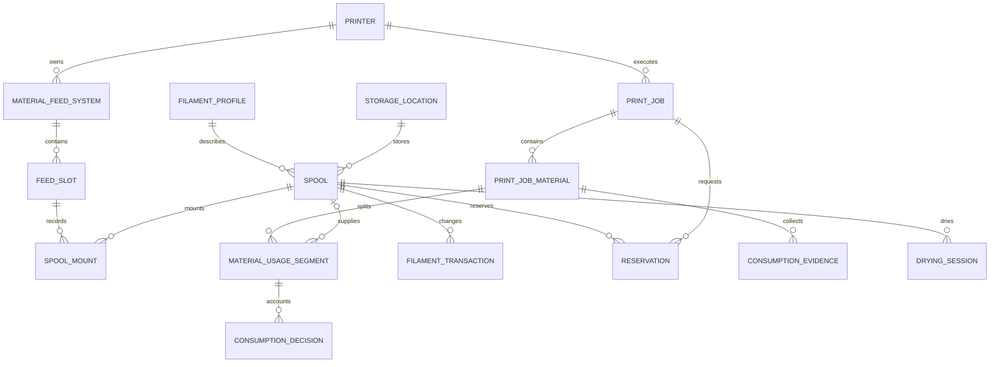

# Universal Filament Manager — DOMAIN_MODEL

## 1. Domain boundaries

Bounded contexts:

1. Inventory
2. Printing
3. Consumption
4. Devices
5. Materials
6. Costing
7. Storage & Drying
8. Alerts
9. Identity & Settings
10. Synchronization

---

## 2. Core entities

Entity fields below use domain units/names. Derived values are read-model fields,
not competing editable storage. Exact persisted columns and types are defined in
[SCHEMA_V1](docs/database/SCHEMA_V1.md); the diagrams and rules here must agree with
that contract. Common device origin, revisions and UTC timestamps apply as defined
in section 24 even where omitted from an abbreviated entity list.

### 2.1 Spool

Fields:

```text
id: UUID
display_name
filament_profile_id
brand_id
batch_number
lot_number
color_name
color_hex
secondary_color_hex
diameter_mm
product_line
density_g_cm3
nominal_filament_weight_g
empty_spool_weight_g
estimated_remaining_g
measured_remaining_g
effective_remaining_g
reserved_g
purchase_price
currency
purchase_date
opened_at
manufactured_at
expires_at
storage_location_id
lifecycle
inventory_health
low_threshold_g
low_threshold_percent
qr_identifier
nfc_identifier
image_uri
notes
created_at
updated_at
archived_at
revision
```

Derived:
- available_g
- remaining_percent
- estimated_length_m
- price_per_gram

Rules:
- measured_remaining_g is authoritative only when measurement quality is trusted.
- effective_remaining_g is selected by reconciliation policy.
- reserved_g is derived from active reservations, not manually edited.
- QR/NFC fields are projections of SpoolIdentifier, not duplicate mutable bindings.

---

### 2.2 FilamentProfile

```text
id
manufacturer_id
product_line
name
material_type
subtype
diameter_mm
density_g_cm3
recommended_nozzle_min_c
recommended_nozzle_max_c
recommended_bed_min_c
recommended_bed_max_c
recommended_chamber_min_c
recommended_chamber_max_c
max_volumetric_speed_mm3_s
drying_temp_c
drying_duration_min
abrasive
flexible
hygroscopic
soluble
filled_material
default_color_name
notes
created_at
updated_at
```

Material enum must allow CUSTOM.

---

### 2.3 Printer

```text
id
name
manufacturer
model
serial_number
enabled
default_slicer_id
nozzle_diameter_mm
build_volume_x_mm
build_volume_y_mm
build_volume_z_mm
has_enclosure
has_camera
has_filament_sensor
has_multi_material_system
firmware_version
last_seen_at
created_at
updated_at
revision
```

Vendor-specific metadata goes in a dedicated extension object/table.
ConnectionProfile owns the unique printer_id FK; the printer's connection profile
is queried through that relationship, not through a reciprocal FK.

---

### 2.4 ConnectionProfile

```text
id
printer_id
provider_type
connection_mode
host
port
tls_enabled
credential_ref
cloud_account_ref
extra_config_json
created_at
updated_at
```

No plaintext secret fields.

---

### 2.5 PrintJob

```text
id
external_job_id
printer_id
project_id
name
file_name
plate_name
source_type
slicer_type
status
detected_at
started_at
paused_at
completed_at
failed_at
cancelled_at
estimated_duration_sec
actual_duration_sec
progress_percent
current_layer
total_layers
thumbnail_uri
failure_code
failure_reason
finalization_state
created_at
updated_at
revision
```

Internal job UUID is the durable identity. External IDs may be reused. Persist a
validated occurrence key scoped by provider, printer and source, plus aliases;
see section 12. Neither filename nor a time bucket is a unique identity.

---

### 2.6 PrintJobMaterial

```text
id
print_job_id
channel_key
tool_index
extruder_index
filament_profile_id
estimated_weight_g
estimated_length_m
created_at
updated_at
```

A job can have 0..N material rows.
Actual weight, confidence and cost are query projections of segment decisions.
Slot and physical spool belong to MaterialUsageSegment, not this logical channel.

---

### 2.7 FilamentTransaction

Append-only.

```text
id
spool_id
transaction_type
delta_g
delta_length_m
unit_cost
currency
print_job_id
reservation_id
source_type
source_event_id
previous_effective_g
new_effective_g
confidence
description
metadata_json
created_at
created_by_device_id
```

Never UPDATE or DELETE a transaction in normal operation.
Corrections are new transactions.

Types:
- INITIAL_STOCK
- PRINT_CONSUMPTION
- PURGE
- LOAD
- UNLOAD
- WASTE
- FAILED_PRINT
- MANUAL_USE
- MEASUREMENT_CORRECTION
- TRANSFER_IN
- TRANSFER_OUT
- RETURN
- INVENTORY_ADJUSTMENT

Reservations are separate stateful objects and should not be encoded as stock-changing transactions until consumed.

---

### 2.8 Reservation

```text
id
spool_id
print_job_material_id
reserved_g
status
created_at
activated_at
consumed_at
released_at
expires_at
settled_finalization_id
allocated_consumption_g
released_g
reason
revision
```

Rules:
- active reservations reduce availability, not physical/effective remaining.
- a consumed reservation belongs to exactly one FinalizationRecord; that record
  may contain several material/segment transactions. Unused reservation amount
  is released in the same transaction. Reserved weight is never the debit amount.

---

### 2.9 ConsumptionEvidence

```text
id
print_job_id
print_job_material_id
source_type
quantity_kind
mode
material_usage_segment_id
weight_g
length_m
confidence
captured_at
received_at
interval_start
interval_end
scope_key
includes_purge
calibration_id
source_event_id
raw_reference
metadata_json
```

Sources:
- SCALE
- PRINTER
- AMS
- SLICER
- THREE_MF
- GCODE
- PROGRESS_ESTIMATE
- MANUAL

---

### 2.10 ConsumptionDecision

```text
id
material_usage_segment_id
finalization_record_id
policy_version
selected_weight_g
confidence
strategy
reason
finalized_at
```

This makes consumption decisions auditable.
DecisionEvidence links every selected ConsumptionEvidence with its role; there is
no single selected_evidence_id shortcut as the authoritative evidence relationship.

---

### 2.11 StorageLocation

```text
id
parent_id
name
type
description
temperature_sensor_id
humidity_sensor_id
created_at
updated_at
```

Types:
- ROOM
- CABINET
- SHELF
- DRY_BOX
- BIN
- OTHER

---

### 2.12 DryingSession

```text
id
spool_id
device_id
started_at
ended_at
target_temp_c
observed_avg_temp_c
duration_min
humidity_before
humidity_after
notes
```

---

### 2.13 SensorDevice

```text
id
device_type
provider_type
name
connection_config_ref
enabled
last_seen_at
metadata_json
```

Types:
- SCALE
- TEMPERATURE
- HUMIDITY
- RFID_READER
- NFC_READER
- CAMERA
- OTHER

---

### 2.14 CostProfile

```text
id
name
currency
electricity_price_per_kwh
machine_hour_rate
labor_hour_rate
maintenance_hour_rate
default_markup_percent
created_at
updated_at
```

---

### 2.15 PrintCostBreakdown

```text
id
print_job_id
filament_cost
electricity_cost
machine_cost
labor_cost
maintenance_cost
waste_cost
other_cost
total_cost
recommended_price
calculated_at
```

---

### 2.16 AlertRule

```text
id
name
enabled
scope_type
scope_id
condition_type
threshold_value
threshold_unit
severity
cooldown_sec
notification_channels
created_at
updated_at
```

---

### 2.17 AlertEvent

```text
id
rule_id
entity_type
entity_id
severity
message_key
message_params_json
raised_at
acknowledged_at
resolved_at
dedupe_key
```

---

### 2.18 DeviceIdentity

Used for future sync.

```text
id
device_name
device_type
public_id
created_at
last_seen_at
```

---

## 3. Relationships



---

## 4. Weight and length calculations

For cylindrical filament:

```text
volume = mass / density
cross_section = π × (diameter / 2)^2
length = volume / cross_section
```

Unit conversion must be explicit.

Do not round internal calculations prematurely.
UI may round for display.

---

## 5. Reconciliation policy

Candidate ordering (only after checking comparability and eligibility):

1. Trusted scale consumption delta with a known interval and spool
2. Printer-reported actual consumption
3. Trusted slicer/3MF estimate
4. G-code estimate
5. Progress-based estimate
6. Manual estimate (an explicit user resolution is recorded separately from an estimate)

But source priority is not enough.

Decision must also consider:
- age of evidence
- whether spool changed during print
- whether multi-material was used
- whether purge/waste is included
- sensor calibration
- provider reliability
- job status
- partial/cancelled print

Absolute remaining weight is InventoryEvidence, not consumption. A scale reading
alone cannot establish print usage. Evidence records identify quantity kind,
unit, spool/segment, interval, cumulative/delta semantics, purge inclusion,
source reference, received time and observed time. Unknown is nullable with an
explicit availability state. Never sum overlapping cumulative observations or
charge purge twice. See [policy contract](docs/STATE_MACHINES.md).

---

## 6. Print finalization logic

### Completed print

1. Receive terminal completion signal.
2. Persist/deduplicate receipt; a pending receipt remains retryable until its
   business processing commits. A receipt collision with a different payload is
   a reconciliation error, not a harmless replay.
3. Lock/fetch job.
4. Verify job not already finalized.
5. Collect consumption evidence.
6. Resolve each material.
7. Claim the job's unique FinalizationRecord and create a decision per resolved
   segment. Each decision retains all selected evidence via a join table.
8. Create FilamentTransaction(s).
9. Consume/release reservation(s).
10. Update derived spool snapshot.
11. Recalculate cost.
12. Commit the finalization record, job, decisions, transactions, reservations,
    projections, audit and pending side-effect intents together.
13. Dispatch notifications after commit; failed delivery retries cannot debit stock.

All accounting DB changes MUST occur in one transaction. Never perform network
calls inside it. No material is charged while any required allocation is unknown.
The initial policy finalizes all segments of a job together; subsequent corrections
use compensating transactions, never a second initial finalization.

### Failed/cancelled print

Never blindly charge 100% of estimated material.

Options:
- trusted scale delta
- printer actual
- progress-based approximation
- manual confirmation
- configurable policy

Default safest behavior:
- estimate probable consumption
- mark low confidence
- mark NEEDS_RECONCILIATION until actual eligible evidence or an explicit,
  audited user resolution exists; elapsed progress is not a mass fraction

---

## 7. Spool switching during a print

This is a major edge case.

A single PrintJobMaterial row is insufficient if a spool is changed mid-print.

Therefore include MaterialUsageSegment:

```text
id
print_job_material_id
spool_id
started_at
ended_at
estimated_usage_g
actual_usage_g
source
```

A print can therefore consume:
- 83 g from spool A
- 54 g from spool B

without corrupting history.

---

## 8. Multi-material systems

Never assume one job = one spool.

Represent:
- extruder/tool index
- slot index
- spool
- usage segment

This supports:
- AMS
- MMU
- IDEX
- tool changers
- manual spool changes

---

## 9. Unknown spool state

If a printer is running but active spool is unknown:
- do not guess silently
- create unresolved material assignment
- queue reconciliation task
- allow user to assign after print
- preserve raw evidence

---

## 10. Depletion edge cases

If computed remaining becomes negative:
- transaction is retained
- spool enters QUARANTINED or INCONSISTENT state
- alert is raised
- UI asks for reconciliation
- never clamp silently to zero because that destroys evidence

---

## 11. Measurement model

Scale readings require:

```text
gross_weight_g
tare_weight_g
net_filament_weight_g
timestamp
sensor_id
calibration_version
stability_score
temperature_optional
```

Reject or flag unstable readings.

---

## 12. Job identity

Avoid identifying jobs by filename alone.

Use a provider-validated occurrence key including printer, source and an
occurrence discriminator (for example an explicitly documented run ID or exact
start identity in the provider's session/epoch). Persist incoming identifiers as
aliases to an internal UUID. File hash, project UUID and timestamps are supporting
evidence; their absence never becomes an empty-string identity.

Reconnect resolves to the existing UUID. Reprinting creates a new occurrence,
even when external ID and filename repeat. If the provider cannot distinguish
these cases, create a reconciliation task and suspend automatic accounting.
Never use timestamp buckets or received-at time as a fabricated run identity.

---

## 13. Project and part entities

Future production workflows require:

### Project
```text
id
name
customer_id_optional
description
created_at
updated_at
```

### Part
```text
id
project_id
name
revision
sku_optional
target_quantity
notes
```

### PrintJobPart
maps print jobs to produced parts and quantities.

---

## 14. Supplier and purchasing model

Future inventory features:

### Supplier
```text
id
name
website
contact_info
notes
```

### Purchase
```text
id
supplier_id
purchase_date
currency
total
shipping_cost
tax
notes
```

### PurchaseItem
links purchased spools/materials and landed cost.

---

## 15. Inventory reconciliation

Periodic inventory count:

### InventoryCount
```text
id
started_at
completed_at
location_id
status
```

### InventoryCountItem
```text
id
inventory_count_id
spool_id
expected_g
measured_g
difference_g
resolved
```

---

## 16. Data deletion policy

Hard deletion should be rare.

Use:
- archived_at
- soft deletion where references exist

Immutable financial/inventory transactions should not be hard-deleted from normal UI.

For privacy-sensitive user data, implement explicit erase workflows separately from operational history.


---

## 17. ReconciliationTask

Conflicts and uncertainty are first-class domain data.

```text
id
entity_type
entity_id
reason_code
severity
status
suggested_action
created_at
resolved_at
resolved_by
resolution_notes
```

Examples:
- ACTIVE_SPOOL_UNKNOWN
- CONSUMPTION_EVIDENCE_CONFLICT
- NEGATIVE_STOCK
- SCALE_READING_IMPLAUSIBLE
- PRINT_INTERRUPTED_WITHOUT_ACTUAL_USAGE
- DUPLICATE_VENDOR_JOB_ID

The system must never hide these situations by silently guessing.

---

## 18. ExternalEventReceipt

Used for durable event deduplication.

```text
id
provider
printer_id
source_epoch
event_key
event_type
payload_hash
received_at
processed_at
processing_result
```

Unique key:
`provider + printer_id + source_epoch + event_key`

An event key can use an external ID only within its documented uniqueness scope.
A fallback fingerprint must include the resolved job occurrence and event
semantics. Keep payload_hash separately to detect key reuse with different data.
Receipt states are PENDING, PROCESSED, REJECTED. Event deduplication is separate
from the unique accounting finalization of a job.
Here `provider` identifies an immutable adapter instance, not merely a brand;
reconnect preserves instance identity, while incompatible reconfiguration gets a
new instance. An optional original external event ID stays sanitized evidence.

---

## 19. MaterialUsageSegment

Required for spool changes and multi-material use.

```text
id
print_job_material_id
spool_id
started_at
ended_at
estimated_usage_g
actual_usage_g
source
confidence
created_at
```

One `PrintJobMaterial` can contain multiple usage segments. This is the canonical
segment entity also introduced in section 7. Include feed_slot_id, spool_mount_id,
tool_index, assignment_state and half-open [started_at, ended_at) boundaries.
spool_id/mount_id can be absent only for unresolved assignment; no deduction is
allowed then. Segments on one material channel cannot overlap. Different tool
channels may overlap. A mount change closes the previous segment and starts the
next in one UnitOfWork, preserving evidence and mount history.

---

## 20. FinalizationRecord

```text
id
print_job_id
idempotency_key
request_hash
started_at
completed_at
result_hash
```

Unique:
`print_job_id` and separately `idempotency_key`.

Two distinct completion keys for the same job must still produce one initial
finalization. Persist a request hash: reuse of a key for different input is a
conflict. Corrections reference prior transactions and do not replace this record.
Committed records are immutable completed accounting outcomes. Transient
IN_PROGRESS belongs to PrintJob.finalization_state inside the accounting UoW.

---

## 21. CalibrationRecord

For scales/sensors.

```text
id
sensor_id
calibration_type
reference_value
offset
scale_factor
temperature_optional
performed_at
expires_at
notes
```

Measurement evidence references the calibration version used.

---

## 22. FeatureFlag

Used to isolate experimental integrations.

```text
id
key
enabled
scope_type
scope_id
rollout_percent_optional
metadata_json
updated_at
```

Experimental vendor integrations must be disableable without database surgery.

## 23. MaterialFeedSystem, FeedSlot and SpoolMount

MaterialFeedSystem: id, printer_id, provider_system_key (optional), kind,
name, created_at, updated_at, revision. Kinds: EXTERNAL, AMS, AMS_LITE, MMU,
IDEX, TOOL_CHANGER, GENERIC. These describe topology; business logic uses capabilities.

FeedSlot: id, feed_system_id, slot_key, tool_index, assignment_state,
observed_at, received_at, revision. Slot identity is unique within its feed system.
P1S without AMS has one EXTERNAL system and one slot, created atomically with
printer setup. Empty, unknown and unavailable are different observations.

SpoolMount: id, feed_slot_id, spool_id, state, mounted_at, unmounted_at,
assignment_source, confidence, source_event_receipt_id, revision.
Only one ACTIVE mount per physical spool AND per slot, enforced by two partial
unique indexes. Closed mounts cannot be reopened or deleted. A rejected competing
mount emits a durable audit event after the failed transaction has rolled back.

SpoolIdentifier: id, spool_id, namespace, kind, value, verified_at, retired_at.
Separate Bambu tray_uuid and tag_uid; neither replaces the internal UUID. An
unverified vendor identifier remains observation evidence and cannot auto-map a
spool. Conflicting mappings are reconciled; identifiers are not reassigned silently.

## 24. Inventory, quantities and concurrency invariants

Physical quantities use integer milligrams in persistence, Decimal grams at
boundaries, with explicit conversion and rejection of unintended fractional mg.
Money uses finite Decimal and canonical decimal strings in SQLite (no REAL path).
Unknown remaining is NULL, not zero. Nominal weight does not establish actual
opening balance without a recorded INITIAL_STOCK basis (including estimated basis).

Each spool has an append-only sequence of transactions. Sequence and command
idempotency keys are unique. Every row satisfies new = previous + delta.
Snapshot, transaction and revision change together. Corrections reference original
transactions; they cannot UPDATE/DELETE history. Transaction directions and
unknown-balance initialization rules are specified in docs/database/SCHEMA_V1.md.

measured_remaining retains the latest trusted absolute reading and its time;
it is historical evidence, not a perpetually current stock balance. On acceptance,
MEASUREMENT_CORRECTION brings effective balance to the measurement at its covered
ledger sequence. Later ledger deltas advance effective balance without rewriting
the measured value. Estimated remaining is a separately reproducible projection:
initialize it from the recorded opening basis, then apply accepted physical
use/return/transfer/adjustment deltas. A MEASUREMENT_CORRECTION leaves it unchanged
unless InventoryReconciliation explicitly adopts a new estimate basis. Ledger
entries store previous/new estimated values and the estimate policy version;
unknown estimate remains unknown until an explicit basis is accepted. Rebuild
replays stored outcomes, never today's policy against historical events.
Stale readings require replay/reconciliation before acceptance. Tare and calibration
must apply to the same physical spool/reading interval.

reserved is the sum of ACTIVE reservations; available = effective - reserved,
and available is NULL when effective is unknown. Only known, healthy balance can
be newly reserved. Check capacity and revision in the same write transaction.
Physical evidence may drive balance below zero: retain the debit, quarantine,
alert and reconcile atomically. Do not put an unconditional nonnegative CHECK on
effective stock. A correction can also invalidate reservations: keep their history,
block new reservations and raise a shortage task instead of silently releasing them.

Moves between storage locations do not change mass. TRANSFER_OUT/TRANSFER_IN are
paired mass transfers between distinct spool inventories with one transfer ID,
opposite equal deltas, explicit authorization and one atomic commit. A spool move
is an audited location change, not these two inventory transactions.

Referenced entities are archived, never cascade-deleted. A mounted spool or spool
with active reservations/unfinished assigned segments cannot be archived.
Storage parents cannot form cycles. All mutable aggregates carry device_id,
revision, created_at/updated_at and optional tombstone; immutable evidence and
ledger rows carry origin and creation time. UTC timestamps must be timezone-aware.

Spool lifecycle, mount state, stock condition and data availability are independent;
the complete enum and transition contract is [STATE_MACHINES](docs/STATE_MACHINES.md).
