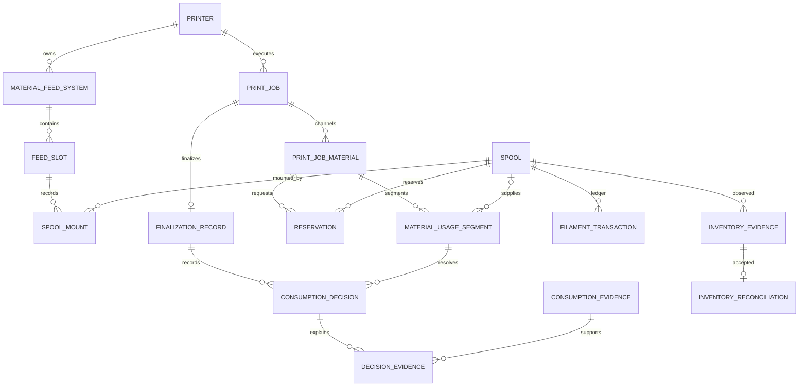

# Repository and domain entity map

This is the target layout. Directories are created when their implementation
starts; an empty vendor folder is not a supported integration. No license has
been selected by the owner; do not invent one.

```text
Universal_Filament_Manager/
  pyproject.toml
  README.md
  ARCHITECTURE.md
  DOMAIN_MODEL.md
  SECURITY_AND_RESILIENCE.md
  RISK_REGISTER.md
  IMPLEMENTATION_PLAN.md
  CHANGELOG.md
  .github/workflows/ci.yml
  src/ufm/
    bootstrap/                 # composition root, startup, shutdown, recovery
    domain/
      entities/                # plain Python entities; no ORM or DTO framework
      value_objects/           # mass, money, identity, UTC time, evidence scope
      enums/                   # orthogonal states
      policies/                # stock, transitions, evidence eligibility
      events/                  # immutable domain events
      errors/                  # stable error codes
    application/
      ports/                   # providers, repositories, UoW, clock, secrets
      dto/                     # immutable normalized boundary models
      commands/                # create spool, mount, reserve, finalize, reconcile
      queries/                 # read models for UI/API
      services/                # inventory, feeds, printing, consumption
      orchestration/           # receipt recovery and bounded workflow retries
    infrastructure/
      persistence/
        models/                # SQLAlchemy mappings
        repositories/
        sqlite/                # pragmas, writer transaction, CAS
        migrations/versions/   # Alembic; immutable released revisions
      logging/
      secrets/
      backup/
      event_bus/
      scheduler/
    integrations/
      printers/bambu/          # first vendor adapter after core gates
      printers/generic/        # explicit manual observations
      slicers/three_mf/
      slicers/gcode/
      scales/manual/
      qr/
    platform/
      common/                  # platformdirs, adapter selection
      windows/
      linux/
      macos/
    ui/
      pages/
      dialogs/
      widgets/
      viewmodels/
      i18n/                    # uk-UA/en-US resource parity
      themes/
      assets/
    workers/                   # lifecycle-owned, cancellable integration workers
  tests/
    unit/
    integration/
    contract/
    migration/
    security/
    crash/
    e2e/
    fixtures/                  # sanitized, provenance recorded
  docs/
    ARCHITECTURE_REVIEW.md
    REPOSITORY_STRUCTURE.md
    STATE_MACHINES.md
    PROVIDER_CONTRACTS.md
    TEST_MATRIX.md
    database/
      SCHEMA_V1.md
      MIGRATIONS.md
    adr/                       # only when a new fundamental decision is needed
    integrations/
    operations/
  packaging/windows/
  packaging/linux/
  packaging/macos/
```

Application ports sit in application because their consumers are use cases.
Domain imports only standard library and its own modules. Infrastructure and
integrations import application/domain contracts; UI imports application query/
command facades. Bootstrap is the only place that selects concrete adapters.
API, PostgreSQL, sync and additional vendors are future directories, not v1 stubs.

## Entity ownership and relationships

| Context / aggregate | Owned entities or references | Principal invariant |
|---|---|---|
| Materials / FilamentProfile | Brand, material properties and custom material name | Profile edits cannot alter historical mass/cost assumptions |
| Inventory / Spool | SpoolIdentifier, transaction projection, location reference | Internal UUID stable; ledger is authoritative for accepted balance |
| Devices / Printer | ConnectionProfile, MaterialFeedSystem, FeedSlot | Configuration has credential_ref only; topology not inferred by brand |
| Feeds / SpoolMount | Slot and physical spool references, historical interval | One active physical mount per spool and slot |
| Printing / PrintJob | JobIdentityAlias, PrintJobMaterial, MaterialUsageSegment | Physical run identity survives reconnect; channels may use multiple spools |
| Inventory / Reservation | Spool, job material, finalization settlement | Capacity is claimed atomically, never debited in advance |
| Consumption / Evidence | ConsumptionEvidence, InventoryEvidence, calibration refs | Source, quantity meaning, time scope and quality preserved |
| Consumption / Decision | ConsumptionDecision, DecisionEvidence, policy snapshot | Per-segment allocation justified and counted once |
| Accounting / Finalization | FinalizationRecord, FilamentTransaction, reservation changes | One atomic initial finalization per job |
| Accounting / Reconciliation | InventoryReconciliation, ReconciliationTask, compensation refs | Corrections append history; unresolved usage blocks unsafe acceptance |
| Integration ingestion | ExternalEventReceipt | Deduped delivery never replaces business idempotency |
| Storage | StorageLocation | Acyclic tree; relocation changes no mass |
| Sensors | SensorDevice, CalibrationRecord | Measurement trust refers to calibration/tare actually used |
| Alerts / Audit | AlertEvent, AuditEvent, PendingEffect | Durable incident/provenance; notifications after commit |
| Local identity | DeviceIdentity, entity revisions | Origin does not imply distributed-write authorization |
| Later costing | CostProfile, PrintCostBreakdown | Finite Decimal, one explicit currency and historical cost basis |
| Later drying | DryingSession | Nonnegative duration, valid spool/device and bounded observations |
| Later production/purchasing | Project, Part, PrintJobPart, Supplier, Purchase, PurchaseItem | Quantities/currency explicit; no implicit changes to stock |



UoW spans aggregates for accounting and mount swaps. An aggregate boundary is not
permission to commit half a physical/accounting operation independently.
