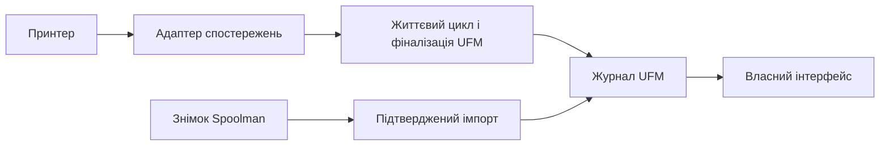
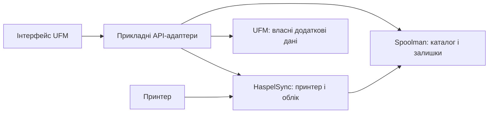

# Об’єднання Spoolman, HaspelSync і Universal Filament Manager

Дата огляду: 25 жовтня 2026 року.

Статус: користувач обрав варіант А, самостійну настільну програму без браузера та Docker, з об’єднаними можливостями Spoolman і HaspelSync та можливістю розширення. Основна інструкція: [план самостійної настільної програми](STANDALONE_DESKTOP_PLAN_UK.md). Цей документ зберігає огляд джерел і попереднє порівняння; він не є дозволом на перемикання робочих даних.

## 1. Що саме об’єднуємо

Мета: використати встановлений локальний стек, завантажені вихідні коди та власну розробку так, щоб отримати зручну систему керування філаментом зі збереженням котушок, залишків, прив’язок принтера та наявної історії.

| Частина | Розташування | Роль |
|---|---|---|
| Локальний стек | `D:\Filament_Manager` | Розгортання Spoolman і HaspelSync через Compose |
| Дані Spoolman | `D:\Filament_Manager\spoolman\spoolman.db` | Наявний інвентар і залишки |
| Налаштування HaspelSync | `D:\Filament_Manager\haspelsync\printers` | Принтери, призначення, стан друку; містить приватні дані |
| Вихідні коди Spoolman | `D:\Filament_Manager\localization\spoolman` | Завантажений код та українська локалізація |
| Вихідні коди HaspelSync | `D:\Filament_Manager\localization\haspelsync` | База локалізованої встановленої версії |
| Власна програма UFM | `D:\Bot\Universal_Filament_Manager` | Python, власна модель інвентарю, SQLite, журнал операцій і desktop |
| Доопрацьований HaspelSync | `D:\Bot\Universal_Filament_Manager\linked-stack\haspelsync` | Окремий checkout із локальними змінами обліку та інтерфейсу |

Власником залишків і журналу обрано UFM. Spoolman і HaspelSync є джерелами даних, функціональних сценаріїв та перевірених прикладів для переходу. Їхні можливості потрібно інтегрувати в модулі одного desktop-продукту.

## 2. Що підтверджено оглядом

### Встановлений стек

У `compose.yaml` задано образи `filament-manager/spoolman:0.27.0-uk` та `filament-manager/haspelsync:1.3.4-uk`. Публікація портів обмежена локальним комп’ютером: Spoolman `127.0.0.1:7912`, HaspelSync `127.0.0.1:4000`. Усередині Compose HaspelSync має звертатися до Spoolman через `http://spoolman:8000`.

Попередній огляд від 24 жовтня зафіксував роботу стека. Перевірка цієї сесії не отримала доступу до каналу Docker Desktop Linux Engine та HTTP на обох портах. Тому поточні запущені образи й доступність сервісів потрібно повторно перевірити на етапі 0. Старий `README_uk.txt` не можна використовувати як єдине свідчення стану запуску.

### Власна програма UFM

Наявні:

- ранній Tkinter-інтерфейс, пошук і перегляд котушок, ручні операції та історія залишків;
- окрема модель з UUID котушок, точними величинами маси, незмінним журналом і транзакційними командами;
- попередній перегляд Spoolman API JSON та імпорт SQLite Spoolman із резервними копіями;
- адаптери OctoPrint, Moonraker і Bambu LAN для спостереження за принтером;
- контракти розміщення котушок, резервування та обліку друку.

Ще потрібні для самостійного автоматичного обліку: завершений механізм фіналізації друку, стійкий фоновий обробник спостережень, надійна ідентичність кожного запуску, прив’язка фізичної котушки та наскрізне приймання. Перегляд стану принтера сам по собі не означає готового списання філаменту.

### Локальні доопрацювання HaspelSync

У checkout із версією `1.3.4-local.1` знайдено:

- `bookings.js`: збереження спроб списання, підтверджених результатів і невизначених результатів;
- `spoolman.js`: вимкнені автоматичні повтори запиту списання;
- `accounting.js`: ціни, знімок собівартості, спроби зважування та звіти;
- `public/accounting.html` і `public/accounting.js`: екран обліку;
- API перегляду історії, зважування та підтвердження невизначених операцій.

Наявність цих файлів підтверджує реалізацію в checkout, але не встановлення саме цього коду в контейнер і не повне приймання на реальному принтері. Опис першого пакета в `linked-stack/README_uk.md` уже вужчий за фактичний код.

## 3. Порівняння двох варіантів

Історичне порівняння до вибору. Для реалізації обрано А; Б не є цільовою архітектурою.

| Питання | Варіант А: самостійна програма UFM | Варіант Б: UFM поверх Spoolman і HaspelSync |
|---|---|---|
| Де істина про залишок | Власний журнал UFM | Spoolman |
| Хто автоматично списує друк | Завершений механізм UFM | Один погоджений екземпляр HaspelSync |
| Роль Spoolman | Джерело переходу; надалі необов’язковий сумісний сервіс | Постійний сервер інвентарю |
| Роль HaspelSync | Тимчасовий компонент; далі його функції замінюються або ізолюються | Постійна інтеграція Bambu й обліку |
| Власний інтерфейс | Повністю над власною моделлю | Єдина оболонка над API сервісів і власними функціями |
| Повторне використання готового | Імпортер, домен, журнал, адаптери, каталог, QR | Наявний стек, локальний HaspelSync, API; UFM як клієнт |
| Найбільша нова робота | Фіналізація, фоновий цикл, перехід даних, повний UI | Живий API-адаптер UFM, межі запису, сумісність і спільний UI |
| Відмова Docker | Після завершення переходу інвентар UFM може працювати самостійно | Функції зовнішнього інвентарю стають недоступними; потрібен режим лише перегляду кешу |
| Власна облікова модель UFM | Використовується як основна | Для спільних котушок не веде незалежний змінюваний залишок |
| Обсяг переходу | Більший | Менший для першого практичного результату |
| Підтримка | Власний продукт і його адаптери | Контракти між трьома компонентами та їхні версії |

Обидва варіанти можуть мати одну точку запуску та зрозумілий інтерфейс. Це не визначає, чи всередині працює один процес або декілька сервісів.

## 4. Правила для обох варіантів

1. Для однієї фізичної котушки в поточному режимі є один авторитетний облік залишку.
2. Один фізичний друк списується один раз. Повторний друк того самого файлу є окремим запуском.
3. Невідомий залишок зберігається як невідомий. Номінальна маса нової котушки не доводить поточного залишку.
4. Колір, матеріал і назва допомагають пошуку, але не підтверджують фізичну котушку.
5. Зважування задає абсолютний залишок після віднімання тари; витрата друку є зміною маси. Ці операції мають різні правила.
6. Втрачена HTTP-відповідь не доводить, що сервер не виконав запит. Невизначений запис потребує звірення.
7. Робочі SQLite-файли двох програм не об’єднуються SQL-копіюванням таблиць. Інтеграція використовує API або погоджений імпорт.
8. Історія, якої немає у джерелі, не відновлюється вигаданими друками. Прийнятий залишок імпортується як початковий запис із походженням.
9. Запити до мережі виконуються поза транзакціями запису UFM.
10. Секрети з HaspelSync не переносяться в журнали, граф знань або документацію. Для UFM зберігається власний `SecretStore`.

## 5. Спільний етап 0: зафіксувати вихідний стан

Результат етапу: короткий протокол стану джерел, перелік резервних копій і таблиця відповідності компонентів для вже обраного варіанта А. Docker-команди нижче стосуються огляду старого розгортання, а не запуску майбутньої настільної програми.

### Крок 0.1. Повторно перевірити фактичне розгортання

Команди тільки для огляду:

```powershell
docker compose -f D:\Filament_Manager\compose.yaml ps
docker ps --format '{{.Names}} | {{.Image}} | {{.Status}} | {{.Ports}}'
Invoke-RestMethod http://127.0.0.1:7912/api/v1/health
```

Зіставити теги й image ID фактичних контейнерів із Compose. Встановити, чи застосовано локальний пакет HaspelSync, і перевірити наявність його API обліку. Визначити активні друки та всі системи, які можуть змінювати ці залишки.

### Крок 0.2. Зафіксувати дані та резервні копії

- Spoolman: узгоджений SQLite snapshot із перевіркою цілісності. Для живої WAL-бази використовувати SQLite backup API або повністю зупинені записи; простого копіювання основного `.db` недостатньо.
- HaspelSync: весь каталог стану принтерів, включно з `bookings.json` і `accounting.json`, якщо вони існують. Не видаляти журнали спроб для повторного запуску операції.
- UFM: визначити фактичний `data-dir`, створити перевірений snapshot його бази та зберегти налаштування окремо від секретів.
- Записати час узгодженої межі даних, кількість котушок, архівних котушок, відомих і невідомих залишків та прив’язки слотів.

Підготовку до перемикання виконувати без активного друку та з явним припиненням записів на погодженій межі. У цій сесії резервні копії й перемикання не виконуються.

### Крок 0.3. Перевірити наявний імпортер

Команда попереднього перегляду не імпортує залишки:

```powershell
Set-Location D:\Bot\Universal_Filament_Manager
& .\.venv312\Scripts\python.exe -m ufm --spoolman-db-preview D:\Filament_Manager\spoolman\spoolman.db
```

Не плутати `--spoolman-db-preview` для SQLite з `--spoolman-preview` для API JSON. Аргумент `--source-instance` зараз підтримує лише JSON preview.

Важливі властивості поточного SQLite-імпортера:

- `source_instance` обчислюється з абсолютного шляху джерела; перенесення тієї самої бази в іншу папку змінює ідентичність імпорту;
- UUID котушки залежить від цього значення та Spoolman ID;
- відомі залишки стають початковими записами журналу;
- повторення незмінного імпорту має захист, але змінений залишок джерела не є підтримуваною живою синхронізацією;
- обробка поновлювана, з транзакціями окремих команд, а не одна атомарна транзакція всього пакета.

Пілотний імпорт виконувати в окремий тестовий `data-dir` з незмінним шляхом підготовленого джерела. Для постійного обміну спочатку потрібна збережена ідентичність екземпляра, незалежна від розташування файла.

## 6. Варіант А: самостійний UFM



### Послідовність

1. Завершити механізм фіналізації: ідентичність запуску, матеріальні сегменти, вибір доказу витрат, проводки, резервування, стан друку та квитанція повтору мають узгоджуватися в одній транзакції.
2. Додати стійкий фоновий цикл спостережень із відновленням після перезапуску. Нормалізовані дані принтера не повинні обходити прикладні команди.
3. Спроєктувати постійне відображення `(екземпляр Spoolman, тип сутності, ID) → UFM UUID`, походження залишку та контроль конфліктів. Не прив’язувати постійну ідентичність до шляху backup-файла.
4. Визначити відображення матеріалів, виробників, котушок, локацій, архівності, міток і слотів. Втрати чи непідтримувані поля показувати у звіті переходу.
5. Провести пробний імпорт у тестовий UFM, перевірити кількості, залишки та повторення. Зберегти вихідну історію Spoolman/HaspelSync як окремий архів, якщо її ще не можна коректно перенести.
6. Завершити користувацький сценарій: котушка, призначення слота, друк, завершення або скасування, витрата, зважування, виправлення, вартість.
7. Провести фонове порівняння без запису UFM у залишки робочого стека. Першим апаратним сценарієм може бути один принтер і одна явно призначена котушка; AMS перевіряється окремо.
8. Після приймання зафіксувати межу переходу, припинити старі записи, прийняти фінальний знімок і ввімкнути одного власника запису в UFM.

Наявний HaspelSync не можна вважати готовим пасивним джерелом подій без перевірки. Для його тимчасового використання в режимі спостережень потрібен окремо реалізований і перевірений режим без записів. Альтернатива: використовувати власний адаптер UFM та вимкнути старий механізм списання перед переходом.

### Приймання

- повтор події та перезапуск процесу не створюють другої витрати;
- повторний запуск того самого файла створює новий друк;
- збій до або після commit не залишає частково завершеного обліку;
- невідома котушка, невідома маса й неоднозначний слот потребують розв’язання;
- скасований або невдалий друк має визначену політику часткових витрат;
- ручна заміна котушки, незавершені сегменти й зважування не подвоюють списання;
- повтор імпорту та зміна розташування snapshot не створюють дублікати після реалізації постійного відображення;
- інвентар доступний після від’єднання принтера.

Після нових записів UFM повернення до старого snapshot Spoolman саме по собі не є коректним відкатом: це втратить нові зміни. Потрібне окреме погоджене перенесення різниці або звірення. Простий відкат можливий до появи нових авторитетних записів.

## 7. Необраний варіант Б, для довідки



### Послідовність

1. Зафіксувати Spoolman як власника залишків для цього режиму. Уже імпортовані залишки UFM не використовувати як паралельний редагований облік тих самих котушок.
2. Ввести явний режим зовнішнього інвентарю та окремий прикладний порт для Spoolman. Це нова робота: нинішній JSON preview не є живим HTTP-клієнтом, а SQLite importer не є синхронізатором.
3. Перший зріз зробити лише для читання: котушки, залишки з походженням, локації, принтери, історія й статус невизначених операцій. Кеш показувати з часом актуальності; недоступність сервісу не перетворювати на нульовий залишок.
4. Під’єднати UFM до погоджених API Spoolman і локального HaspelSync. На хості використовуються опубліковані адреси; `spoolman:8000` працює в контейнерній мережі, а не як звичайна адреса Windows.
5. Для власних записів UFM зберігати зовнішні ID з постійним ідентифікатором екземпляра. Залишки отримувати з Spoolman, а додаткові власні сутності зберігати окремо.
6. Перевірити локальний HaspelSync на тестових сервісах і даних. Спершу звірити поточні можливості checkout, тести та процедуру збирання; тоді готувати конкретний образ для застосування.
7. Додавати операції запису по одній. Створення котушки, ручна корекція та списання друку мають окремі контракти. Для однієї витрати UFM не надсилає другий запит, якщо її вже обробляє HaspelSync.
8. Зважування й розв’язання невизначених записів проводити через один погоджений механізм із перевірками активного друку та незавершених спроб. Прямі редагування у Spoolman також потрібно врахувати в процедурі роботи.
9. Додати єдину точку запуску, перевірку доступності сервісів, зрозумілі повідомлення та відкриття потрібних екранів. Об’єднання інтерфейсу не повинно маскувати відмову окремого сервісу.

### Особливості API

Spoolman `PUT /api/v1/spool/{id}/use` додає витрачену масу повторно за кожного виконаного запиту. Його не можна безумовно повторювати через timeout. Локальний журнал HaspelSync знижує ризик повтору, але не створює спільної транзакції зі Spoolman. Багатокотушковий друк може мати часткове застосування та потребувати звірення.

Кандидати для клієнта UFM, наявні саме в локальному checkout HaspelSync:

| API | Призначення |
|---|---|
| `GET /api/print/{printerId}/bookings` | Спроби списання |
| `GET /api/print/{printerId}/report` | Звіт витрат і вартості |
| `GET /api/accounting` | Дані цін і зважувань |
| `PUT /api/accounting/cost/{id}` | Профіль вартості |
| `POST /api/accounting/weigh/{id}` | Контрольована спроба зважування |
| `POST /api/print/{printerId}/bookings/{id}/resolve` | Підтвердження результату спроби |
| `POST /api/accounting/weighings/{id}/resolve` | Підтвердження результату зважування |

Перед підключенням клієнта перевірити схеми, авторизацію та наявність цих маршрутів у фактично запущеному образі. Підтвердження результату не дорівнює повторному виконанню списання.

### Приймання

- UFM показує ті самі поточні залишки, що Spoolman;
- режим зовнішнього інвентарю не дозволяє незалежну проводку UFM для спільної котушки;
- повторне відкриття екрана чи мережевий повтор не змінює масу;
- timeout, HTTP-помилка й збій після серверного запису відображаються коректно;
- невизначені операції не повторюються автоматично;
- історія, тари, невідомі значення й валюти зберігають свій зміст;
- відкат інтерфейсу або контейнера зберігає журнали спроб і нові дані.

## 8. Як використати завантажені вихідні коди

Встановлені дані залишаються в `D:\Filament_Manager`. Зміни готуються у визначеному checkout із зафіксованою базою, окремим образом і відтворюваною збіркою. Завантажена папка вихідних кодів не стає робочою версією сервісу автоматично.

Для Spoolman спочатку використовувати API; зміна його схеми є окремим рішенням. Для HaspelSync врахувати вже підготовлений локальний fork, щоб не загубити захист списань, екран обліку й український переклад.

Локальні документи вказують MIT для Spoolman та GPL-3.0-only для HaspelSync. Перед прямим перенесенням коду потрібне окреме рішення щодо ліцензії й поширення та перевірка повідомлень у конкретних файлах. Цей документ не визначає ліцензію UFM і не включає сторонній код до нього.

## 9. Пакети робіт після вибору

| Пакет | Результат | Залежність |
|---|---|---|
| 0 | Перевірений вихідний стан і snapshots для переходу на А | Спільний |
| А1 | Завершена атомарна фіналізація UFM | Лише А |
| А2 | Стійкі спостереження, ідентичність друку, призначення котушок | А1 |
| А3 | Постійна відповідність ID і пілот переходу | А1, тестова база |
| А4 | Наскрізне приймання, погоджене перемикання | А2, А3 |
| Б1 | Режим зовнішнього інвентарю, API-порти, перегляд | Лише Б |
| Б2 | Перевірена локальна версія HaspelSync і сценарії збоїв | Б1, тестовий стек |
| Б3 | Погоджені записи, історія, зважування, вартість | Б1, Б2 |
| Б4 | Спільний запуск і приймання | Б3 |

Для кожного пакета фіксувати: змінені модулі, схему даних, власника запису, тести, фактичний результат і відкат. Для змін HaspelSync спочатку прочитати його `AGENTS.md` та `src/AGENTS.md`.

Після реалізації запускати відповідні перевірки UFM і HaspelSync. Наявні старі результати тестів не вважати перевіркою нової інтеграції. Для самого цього документа тести програм не запускалися: перевірялися джерела, CLI-контракти, конфігурація та наявні графи.

## 10. Зафіксоване рішення користувача

Потрібна одна самостійна програма з нативним вікном, без браузера та Docker. Можливості Spoolman і HaspelSync об’єднуються в UFM із власною базою та розширюваними контрактами модулів. Підключення до вже запущених Spoolman/HaspelSync не є обов’язковою умовою її роботи.

Рішення:

```text
Варіант: А, самостійний desktop UFM
Головний інтерфейс: нативний PySide6
Власник залишків: UFM, SQLite та незмінний журнал
Постачання: програма для Windows із запакованими залежностями
Розширення: модулі за контрактами; сторонні плагіни окремим етапом
Перша вертикаль: котушка → призначення → друк → витрата → історія
Послідовність: STANDALONE_DESKTOP_PLAN_UK.md та канонічні етапи IMPLEMENTATION_PLAN.md
```

## 11. Інструкція для наступного етапу розробки

> Використовуй STANDALONE_DESKTOP_PLAN_UK.md як цільову інструкцію. Розвивай одну нативну програму UFM без браузера, Docker та обов’язкових сторонніх серверів інвентарю. Збережи наявне доменне ядро й реалізуй можливості Spoolman/HaspelSync через прикладні модулі та адаптери. Дотримуйся канонічних етапів, перевірок фіналізації й міграцій. Підготуй перший обмежений пакет реалізації; поточні дані та працюючий старий облік перемикай лише в межах окремо погодженого переходу.

## 12. Підстава інструкції

- [Конфігурація локального стека](../../../Filament_Manager/compose.yaml).
- [Поточний опис UFM](../README.md) і [реалізовані етапи](IMPLEMENTATION_STATUS.md).
- [Архітектура UFM](../ARCHITECTURE.md), [модель даних](../DOMAIN_MODEL.md), [провайдери принтерів](PRINTER_PROVIDERS.md).
- [Попередній огляд локального стека](LOCAL_FILAMENT_MANAGER_REVIEW.md) і [огляд повторного використання](GITHUB_REUSE_REVIEW.md).
- [Імпортер Spoolman](../src/ufm/integrations/spoolman/importer.py), зокрема `_source_instance` і `import_spoolman_database`.
- [Примітки локального HaspelSync](../linked-stack/README_uk.md), [перша версія захисту списань](../linked-stack/haspelsync/docs/local-safe-booking.md).
- [Журнал списань](../linked-stack/haspelsync/src/bookings.js), [облік і зважування](../linked-stack/haspelsync/src/accounting.js), [HTTP-контракти](../linked-stack/haspelsync/src/routes.js), [екран обліку](../linked-stack/haspelsync/public/accounting.js).
- Графи `D:\Filament_Manager\graphify-out\graph.json` і `D:\Bot\Universal_Filament_Manager\graphify-out\graph.json`; факти, важливі для плану, додатково звірено з вихідними файлами.
