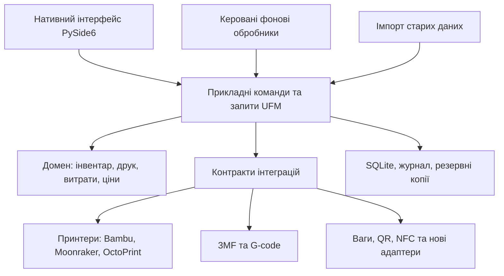

# Одна настільна програма: UFM + можливості Spoolman і HaspelSync

Рішення користувача зафіксовано 25 жовтня 2026 року.

## 1. Мета продукту

Створити одну самостійну настільну програму, яка об’єднає інвентар Spoolman, інтеграцію принтерів і облік HaspelSync та власні можливості Universal Filament Manager.

Користувач встановлює програму, відкриває звичайне вікно, підключає принтер і працює з котушками. Браузер, Docker, окремий сервер Spoolman та окремий HaspelSync для її щоденної роботи не потрібні. Програма має дозволяти додавання нових принтерів, датчиків, екранів та інших функцій через визначені контракти.

Це зафіксована ціль розробки. Нижче описані необхідні роботи; готовність функцій потрібно підтверджувати окремо.

## 2. Технічна основа

| Частина | Рішення |
|---|---|
| База проєкту | Наявний `D:\Bot\Universal_Filament_Manager` |
| Мова ядра | Python, поточні доменні та прикладні контракти UFM |
| Інтерфейс | Нативний PySide6, звичайні вікна й віджети |
| Поточний Tkinter | Попередня оболонка для звірення наявних сценаріїв; цільовий UI замінюється поетапно |
| Дані | Власна локальна SQLite із міграціями, незмінним журналом і резервними копіями |
| Підключення принтерів | Власні адаптери через `PrinterProvider`, MQTT/TLS, FTPS або потрібний протокол пристрою |
| Облік друку | Прикладний механізм UFM із атомарною фіналізацією та захистом повтору |
| Фонова робота | Керовані програмою workers із відновленням і коректним завершенням |
| Постачання | Перший інсталятор для Windows, `.exe` та запаковані Python/Qt-залежності |
| Інші ОС | Збереження переносимої архітектури; підтримка підтверджується запуском на кожній ОС |
| Розширення | Контракти адаптерів, реєстр модулів, явні capabilities і версії |

Інтерфейс не будується на сторінці localhost або вбудованому браузері. Користувач не встановлює Node.js, Python чи контейнери окремо для готової Windows-версії. Допоміжні процеси, якщо потрібні, постачаються і керуються як частина одного продукту.

## 3. Єдина архітектура

Власник прийнятих залишків один: UFM. Усі зміни маси проходять через його прикладні команди та журнал. UI й адаптери не виконують довільні SQL-зміни та не встановлюють баланс напряму.

Spoolman і HaspelSync потрібні як джерела переходу, сценаріїв, форматів та матеріалів для перевірки. Сумісність із їхніми API може бути додатковою функцією, але не умовою запуску нового продукту.

## 4. Які можливості об’єднуємо

| Область | Що переносимо у продукт | Основа та нова робота |
|---|---|---|
| Матеріали та виробники | Каталог, профілі, колір, діаметр, густина, посилання на зовнішній каталог | Розвинути моделі й імпорт UFM; зберігати походження довідникових значень |
| Котушки | Створення, пошук, залишок, тара, локація, архів, примітки, додаткові поля | Використати наявні команди інвентарю UFM та розширити read-моделі |
| Принтери | Налаштування підключень, стан, прогрес, матеріальні слоти | Розвинути наявні адаптери й фоновий цикл |
| Подача філаменту | Зовнішня котушка, AMS, призначення і заміна котушок | Доменні `FeedSlot` і `SpoolMount`, явна ідентичність та історія |
| Файли друку | 3MF/G-code, матеріали, пластини, інструменти й оцінки витрат | Окремі обмежені парсери через `SlicerProvider` |
| Облік друку | Початок, завершення, скасування, часткові витрати, повторний друк | Завершити фіналізацію UFM та стійку ідентичність запусків |
| Історія | Друки, операції маси, походження, невизначені події | Власні таблиці/запити, збережений старий архів і контрольований імпорт |
| Зважування | Вага брутто, тара, нетто, корекція й звірення | Прикладні команди UFM з межею вже врахованих витрат |
| Вартість | Ціна на визначену масу, валюта, собівартість друку | Точні величини й історичний знімок ціни |
| Ідентифікація | Етикетки QR, надалі сканування/NFC | Наявний генератор QR UFM, окремі адаптери введення |
| Експлуатація | Налаштування, українська/англійська, діагностика, копії та відновлення | Наявні ресурси UFM і нові нативні екрани |

Матеріал і колір дають кандидата на призначення; вони не доводять, що саме ця фізична котушка встановлена. Розрахункова витрата з файла не стає виміряною масою лише через завершення друку.

## 5. Розширюваність

Почати з модульного ядра та вбудованих адаптерів. Це дозволяє розширювати програму без попереднього створення магазину плагінів.

Контракти:

- `PrinterProvider`: стан, можливості, події та життєвий цикл з’єднання;
- `SlicerProvider`: аналіз 3MF/G-code з обмеженнями ресурсів;
- `ScaleProvider`: підключення ваг, калібрування та стабільні покази;
- `SecretStore`, резервування даних і сповіщення: платформа та зовнішні ефекти;
- окремі прикладні команди й запити для нових екранів.

Реєстр модулів створюється в composition root. Опис модуля містить стабільний ID, версію контракту, можливості, необхідну конфігурацію та перелік дозволених операцій. Додавання нового виробника не змінює правила обліку: UI використовує capabilities, а адаптер повертає нормалізовані DTO.

Зовнішні сторонні плагіни є наступним етапом. Для них потрібно визначити сумісність версій, дозволи, ізоляцію й контрольований канал команд. Плагін не отримує прямий запис у SQLite або необмежений доступ до секретів. Його відмова не повинна ламати інвентар.

Міграції даних розширень мають окрему версію й перевірку сумісності. Завантаження стороннього коду не виконується автоматично з довільної папки.

## 6. План реалізації

Нумерація канонічних фаз у [IMPLEMENTATION_PLAN](../IMPLEMENTATION_PLAN.md) зберігається. Наведені нижче пакети пояснюють обрану ціль і порядок робіт, не оголошують старі фази завершеними.

### Пакет 1. Завершити облікове ядро

Перевірити й закрити відкриті передумови фаз 3–5, реалізувати фазу 6: докази витрат, їхній часовий і матеріальний обсяг, рішення, проводки, резерви, стан друку та квитанцію виконання.

Критерій: одна початкова фіналізація на фізичний запуск; повторні події та перезапуски не дублюють витрату. Помилки до або після commit дають відтворюваний стан. Невідомі дані створюють завдання звірення.

### Пакет 2. Підготувати перехід даних

Розширити наявний імпортер постійною ідентичністю джерела, незалежною від шляху SQLite, і збереженою відповідністю зовнішніх ID внутрішнім UUID. Підготувати попередній перегляд, підтвердження початкових залишків, snapshots і повторюваний пробний імпорт.

Охопити котушки, матеріали, виробників, локації, архівність та потрібні мітки. Налаштування принтерів і призначення HaspelSync переносяться окремими перевіреними операціями. Секрети вводяться/переносяться лише через погоджений механізм `SecretStore`.

Старі записи `bookings.json` і `accounting.json`, якщо наявні, зберегти. Підтверджені історичні списання, уже включені до прийнятого залишку, імпортувати як історію походження, без повторного дебету. Невизначені операції потребують звірення до перемикання.

Критерій: кількості й прийняті залишки звірені; невідомі значення збережені; повтор того самого джерела не створює дублікати. Непідтримувана історія залишається доступним архівом із явним звітом втрат/обмежень.

### Пакет 3. Побудувати нативний інтерфейс

Після перевіреного облікового ядра реалізувати фазу 7 на PySide6: головна панель, котушки та деталі, каталог, принтери/слоти, друки/історія, зважування, налаштування й діагностика.

Використовувати прикладні команди й запити. Мережеві дії та довгі операції не блокують UI. Зберегти українську й англійську, темну/світлу/системну тему та зрозумілі повідомлення про невідомі дані.

Критерій: локальний користувацький сценарій працює у звичайному вікні без браузера, HTTP-інтерфейсу та запущених Spoolman/HaspelSync.

### Пакет 4. Довести прямі інтеграції до повного циклу друку

За фазами 8–11: підключення й відновлення принтера, аналіз файла, стійка ідентичність запуску, призначення котушок, сегменти при заміні й безпечне завершення обліку.

Початкова вертикаль відповідає чинному плану UFM: Bambu P1S з однією явно призначеною котушкою. Підтримку AMS розширювати на тому самому `FeedSystem`/`FeedSlot`, з окремим прийманням для його топології. Не обмежувати домен конкретним виробником.

Критерій: контрольований реальний друк дає одну коректну витрату, запис історії та пояснення джерела маси. Перепідключення зберігає ідентичність поточного друку, а повторний запуск того самого файла створює нову. Період відсутності програми або пропуск телеметрії потребує відновлення/звірення, якщо доказів недостатньо.

### Пакет 5. Об’єднати зважування, вартість та ідентифікацію

Довести сценарії фаз 12–14: ручне зважування з тарою та межею врахованого обліку, підтвердження невизначених витрат, ціни на одиницю маси, собівартість друку, етикетки QR. Далі додавати фізичні ваги та інші джерела через адаптери.

Критерій: зважування не дублює ще не фіналізовану витрату; зміна поточної ціни не переписує вартість минулих друків; різні валюти не додаються без явного правила.

### Пакет 6. Випустити окрему програму

Підготувати Windows-інсталятор із запакованими залежностями, ярлик, іконку, версію, локальний каталог даних, оновлення з резервною копією та перевірене відновлення.

Визначити поведінку закриття вікна й моніторингу: повне завершення або явно ввімкнена робота в треї. Показувати, коли фоновий облік активний. Виключити два одночасні власники запису в одну базу.

Критерій: на окремому тестовому Windows-профілі програма встановлюється й працює без Docker, браузера та окремо встановлених Python/Node.js. Локальний інвентар доступний без мережі; адаптер, який відмовив, не блокує запуск програми.

## 7. Критерії завершеного першого продукту

Детальна [матриця паритету функцій і умов розповсюдження](FEATURE_PARITY_RELEASE_UK.md) відокремлює готовність першої вертикалі від повного функціоналу Spoolman/HaspelSync. Вона є основою обліку готовності випуску.

1. Є один інсталятор і нативне вікно програми.
2. Дані старого стека перенесені зі звітом, перевіреними копіями та стабільною відповідністю котушок.
3. Користувач бачить каталог, залишки, локації, історію та принтер в одному інтерфейсі.
4. Один реальний друк списується один раз; повторні події, збій і повторний запуск файла перевірені.
5. Невідомі та суперечливі дані можна розв’язати без прихованого переписування історії.
6. Зважування, тари, оцінки й виміряні значення розрізняються.
7. Працюють резервування, перевірка відновлення та діагностика без секретів.
8. Новий тестовий адаптер можна зареєструвати через контракт без змін доменного обліку.
9. Підтримані ОС, принтери та функції названі відповідно до фактично виконаних перевірок.

## 8. Правила переходу

Старі дані й програми залишаються джерелом для огляду до готовності нового циклу. Пробні імпорти використовують окрему базу. Перед остаточним переходом потрібно узгодити межу даних і припинити старі записи для тих самих котушок.

Після появи нових авторитетних записів UFM повернення до старого snapshot не зберігає ці зміни. Відкат після такого моменту передбачає звірення або погоджений експорт різниці.

Можливості локального HaspelSync відтворюються через контракти UFM та перевірені сценарії. Чинна політика проєкту щодо перенесення стороннього коду й ліцензій зберігається; функціональна інтеграція не означає автоматичного копіювання всіх JS-модулів у Python-проєкт.

## 9. Перша конкретна робота після цієї інструкції

Почати з перевірки відкритих облікових передумов і реалізації обмеженого механізму фіналізації на синтетичних даних. Використати існуючі сутності, репозиторії та UnitOfWork. Зв’язок із реальним принтером підключити після перевірок повтору, відновлення й атомарності.

Після пакета показувати змінені файли, результати відповідних тестів, поточні обмеження та наступний пакет. План і створення документації не вважаються реалізованою настільною програмою.

## 10. Пов’язані документи

- [Огляд джерел і зафіксований вибір А](SPOOLMAN_UFM_INTEGRATION_UK.md).
- [Архітектура](../ARCHITECTURE.md), [модель даних](../DOMAIN_MODEL.md), [канонічні фази](../IMPLEMENTATION_PLAN.md).
- [Поточна реалізація](IMPLEMENTATION_STATUS.md), [структура модулів](REPOSITORY_STRUCTURE.md), [контракти провайдерів](PROVIDER_CONTRACTS.md).
- [Імпортер Spoolman](../src/ufm/integrations/spoolman/importer.py) та [поточні адаптери принтерів](PRINTER_PROVIDERS.md).
